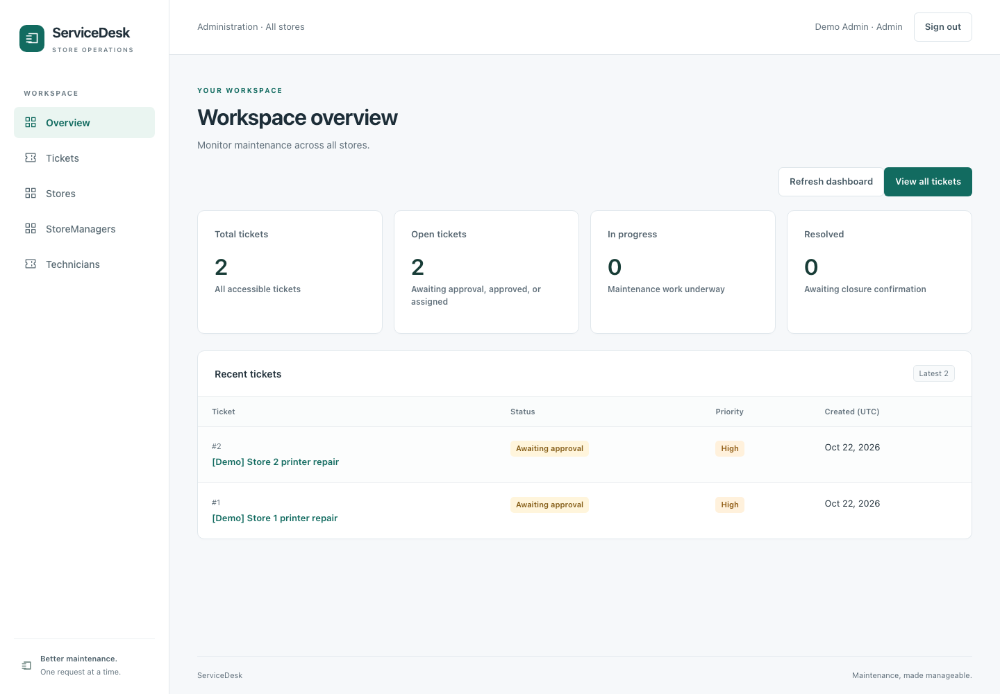
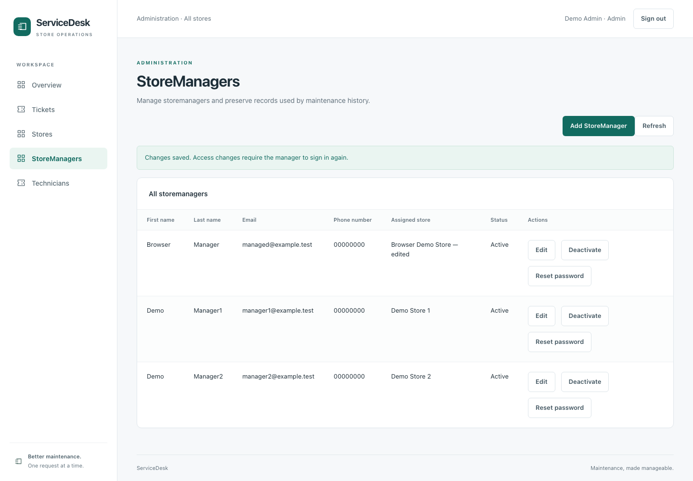

# ServiceDesk

A full-stack maintenance application for coordinating repairs across multiple
stores. StoreManagers report problems and verify repairs; Admins review requests,
schedule external technicians, and maintain store/contact records.

Built with **ASP.NET Core 10, C#, React, TypeScript, Vite, EF Core, and SQL Server**.

## Run it

Follow [the local setup guide](docs/SETUP.md) for prerequisites, Docker-hosted SQL,
private configuration, migrations, demo accounts, and startup commands. The API
and frontend run natively; the database has a repeatable Compose configuration.

Use [the portfolio demonstration](docs/DEMO.md) for the two-role walkthrough,
screenshot checklist, and interview talking points. The screenshots below are
actual Chromium renders of disposable demo data.

## Working features

- Shared login/logout with signed 30-minute JWTs and server-enforced roles.
- StoreManager dashboard/tickets scoped to the assigned store; Admin overview
  across all stores. One manager account belongs to one store.
- Create/edit tickets, title search, combined status/priority filters, result
  counts, dashboard summaries, and the five newest accessible tickets.
- Approval/rejection, technician assignment with a future visit, progress,
  resolution, closure, and status history with trusted actors and UTC timestamps.
- Named stores, categories, technicians, and users on ticket/assignment/history
  views. Missing references use explicit ID fallbacks; names reflect current data.
- Admin store/technician list, create, edit, deactivate, and reactivate screens.
- Loading, empty, error/retry, form-validation, and responsive workspace states.
- Admin StoreManager creation/editing, store reassignment, activation, and password
  reset with hashed passwords and invalidation of previous sessions.
- Optimistic concurrency, restrictive foreign keys, safe Problem Details errors,
  login rate limiting, and Admin-only audited status corrections.
- Explicit, idempotent Development demo provisioning with hashed passwords.

## Workflow and permissions

```text
AwaitingApproval → Approved → Assigned → InProgress → Resolved → Closed
        └──────→ Rejected
```

| Operation | Admin | StoreManager |
|---|---|---|
| Dashboard/list/detail/history/assignment | All stores | Assigned store only |
| Create/edit tickets | All stores | Assigned store only |
| Approve/reject/assign technician | Yes | No |
| Start progress / resolve | All stores | Assigned store only |
| Close resolved tickets | All stores | No |
| Manage stores, technicians and manager accounts | Yes | No |
| Correct the latest recorded status event | Yes, with reason | No |

The API checks store access before manager reads/writes. Missing and inaccessible
tickets return the same 404. Invalid transitions return 409; clients cannot skip
stages. Creator, assigning user, and history actors come from the validated JWT.
Technicians are external contacts without application accounts.

Deactivated stores accept no new tickets, but existing work remains accessible
and can finish. Inactive technicians cannot receive new assignments. Existing
assignments and history remain readable. Records are not physically deleted.

Open dashboard tickets include AwaitingApproval, Approved, and Assigned.
InProgress and Resolved have separate counts; Closed and Rejected contribute to
the total. Filtering/summaries currently use the complete authorized ticket list.

## Architecture

```text
frontend/ → HTTP → ServiceDesk.Api → ServiceDesk.Application → ServiceDesk.Domain
                       ↓                    ↑
                 ServiceDesk.Infrastructure → SQL Server
```

- **Domain:** entities, validation, and lifecycle methods; no EF/HTTP dependencies.
- **Application:** use cases and repository/transaction contracts.
- **Infrastructure:** EF mappings, repositories, batched name resolution, migrations,
  and SQL transaction implementation.
- **API:** authenticated endpoints, DTOs, validation responses, policies, and DI.
- **frontend/:** React pages, typed API clients, accessible forms, and derived views.
- **Tests:** domain/application checks, real JWT middleware/API authorization,
  frontend contract/behavior tests, and opt-in SQL integration tests.

Each workflow action shares one explicit transaction across ticket, assignment,
and history writes using the scoped DbContext. Failure rolls back all writes and
clears EF tracking. Create/edit remain single-save operations. SQL rowversions
prevent stale updates from overwriting newer changes. Closed/rejected tickets
must first be corrected back to an editable state. Corrections append history;
they do not erase the mistaken event. See [security and consistency](docs/SECURITY.md).

## API overview

- `POST /api/auth/login`: returns a bearer token, expiry, and safe user/store details.
- `GET/POST /api/tickets`, `GET/PUT /api/tickets/{id}`.
- `POST /api/tickets/{id}/{approve|reject|assign|progress|resolve|close}`.
- `GET /api/tickets/{id}/history` and `/assignment` (204 if no assignment).
- `GET /api/stores`, `/categories`, `/external-technicians` for active choices;
  technician directory access is Admin-only.
- Admin-only `/api/admin/stores`, `/api/admin/external-technicians`, and
  `/api/admin/store-managers`: GET lists
  including inactive records, POST create, PUT `/{id}` edit, PATCH `/{id}/status`
  with `isActive` and the current `expectedVersion`.
- StoreManager POST creation includes an initial password; POST
  `/{id}/reset-password` accepts a new password and `expectedVersion`.
- POST `/api/tickets/{id}/correct-status` requires the latest `eventId`, a reason,
  and `expectedVersion`. Only Admin can use it.

Existing-record mutations require `expectedVersion` from the latest response's
`version`; stale writes return 409. Creating a record does not require a version.

Swagger in Development provides an Authorize control for bearer tokens. Display
responses contain names/IDs only where needed; no password hashes or signing keys.

## Verification

```sh
dotnet build
dotnet test
npm --prefix frontend test
npm --prefix frontend run lint
npm --prefix frontend run build
```

Latest checks: **122 backend tests with SQL enabled**, **64 frontend unit tests**,
and **2 Chromium end-to-end tests passed**. Builds/lint passed. The browser tests
exercise actual UI forms, both store scopes, stale writes, Admin-only closure and
correction, account/session changes, and mobile layout. SQL checks include
competing transactions, rollback, restrictive references and seed idempotency.

The hardening migration was verified against a restored populated database copy
before applying it locally. Record counts and existing active accounts were
preserved, and a fresh local safety backup was retained. Earlier clean-checkout
restore/migration/seed verification is documented in [setup](docs/SETUP.md).

Run `python3 scripts/run-browser-tests.py` with the private SQL test connection to
repeat the isolated browser checks and regenerate the screenshots. See the setup
guide for Chromium installation and test database cleanup.

Privately set `SERVICEDESK_TEST_SQL_CONNECTION` to enable SQL tests. They override
the supplied database name with `ServiceDesk_TransactionTests_<guid>`, migrate a
fresh database, verify real commits/rollback/retry/administration/demo seeding,
and delete it afterward. The supplied database is not migrated or cleared.
Use a local login allowed to create/drop databases. Interrupted processes may
leave a test-prefixed database requiring manual cleanup.

## Security and limits

Secrets belong in user-secrets or environment configuration outside Git. Tokens
stay only in browser memory: reload, logout, expiry, or 401 requires sign-in.
Logout does not revoke copied tokens. Use HTTPS for hosted environments.

This release targets a local portfolio demo. Public deployment, multi-store
manager assignments, refresh tokens, per-session logout revocation, public
password recovery, notifications, historical name snapshots and server-side
pagination remain deferred. Account access/password/store changes invalidate old
tokens. Application passwords contain 8–128 characters.

## Actual application screenshots




More screenshots: [ticket filters](docs/screenshots/ticket-filters.png),
[assignment and correction history](docs/screenshots/ticket-history.png),
[manager workspace](docs/screenshots/manager-workspace.png),
[mobile layout](docs/screenshots/manager-mobile.png),
[stores](docs/screenshots/store-administration.png), and
[technicians](docs/screenshots/technician-administration.png).
